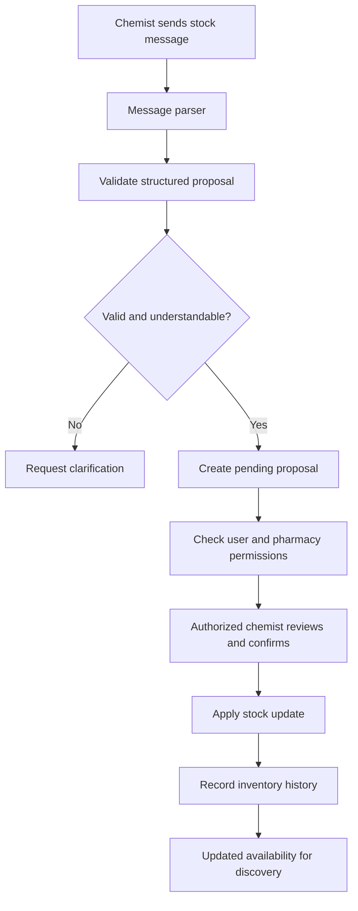
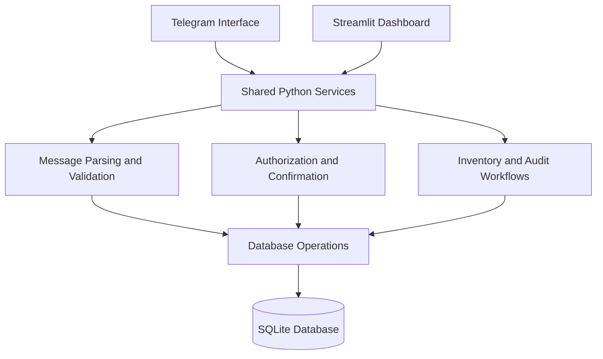

# MediBridge 💊
### Connecting Patients to Nearby Pharmacies Through Smarter Medicine Availability

<p align="center">
  <strong>Find medicines. Verify availability. Make access simpler.</strong>
</p>

<p align="center">
  
  
  
  
</p>

---

## 🌐 Overview

**MediBridge** is a pharmacy connectivity platform designed to make medicine availability easier to discover and manage.

Finding a medicine can be frustrating when patients have to call multiple pharmacies, travel between locations, or rely on outdated stock information. At the same time, pharmacies need a simple way to maintain accurate inventory without complicated workflows.

MediBridge aims to bridge this gap by connecting patients with nearby pharmacies and simplifying stock updates through natural-language messages.

The platform is being developed with a focus on usability, reliable inventory management, and human-verified stock updates.

## 🚨 The Problem

- **Uncertain availability:** Patients may visit pharmacies without knowing whether a medicine is in stock.
- **Time-consuming searches:** Finding a medicine can involve contacting multiple pharmacies.
- **Manual inventory management:** Updating stock records can be tedious for pharmacy staff.
- **Outdated information:** Unconfirmed inventory data can lead to misleading availability results.
- **Limited accessibility:** Not every pharmacy has access to sophisticated inventory-management software.

## 💡 Our Solution

MediBridge aims to create a simpler connection between patients and pharmacies through a shared inventory workflow.

- 🔎 **Medicine discovery:** Search for medicines and identify nearby pharmacies with relevant availability information.
- 💬 **Natural-language stock updates:** Allow chemists to communicate stock information using familiar messages.
- 🧠 **Structured message parsing:** Convert supported English, Hindi, and Hinglish messages into structured stock proposals.
- 🛡️ **Human-verified updates:** Require confirmation from an authorized chemist before a proposed stock change becomes official.
- 📋 **Inventory history:** Maintain an audit trail of changes and support safe undo operations.
- 💊 **Substitute discovery:** Help identify potential alternatives based on medicine composition, strength, and form, with pharmacist approval where required.

> **Our principle:** An interpreted message is a proposal, not proof of actual stock. Inventory changes must follow the appropriate verification and confirmation workflow.

## ⚙️ How It Works



The diagram represents the intended end-to-end workflow. Database integration, confirmation handling, and the complete application flow are still under development.

### Example

A chemist sends:

`Dolo 650 ke 20 strips hain`

The parser attempts to extract the medicine name, strength, quantity, and stock status. The resulting structured proposal can then be validated and passed to the appropriate workflow.

The parser does **not** directly write to the inventory database.

## ✨ Key Features

| Feature | Description | Development status |
|---|---|---|
| Stock message parser | Parses supported English, Hindi, and Hinglish stock messages | Implemented; tested |
| Input validation | Validates proposal structure and field constraints | Implemented; tested |
| Pharmacy inventory database | Stores medicines, pharmacies, stock, and history | In development |
| Stock proposal workflow | Creates, reviews, confirms, and applies proposals | Planned integration |
| Authorization | Checks user membership and role permissions | Planned integration |
| Audit trail and undo | Records stock changes and supports controlled reversals | Planned |
| Medicine search | Finds medicines using names and aliases | Planned |
| Substitute workflow | Supports per-request pharmacist approval | Planned |
| Telegram interface | Provides a conversational interface for pharmacy workflows | Planned integration |
| Streamlit dashboard | Provides a dashboard for inventory and proposal management | Planned integration |

## 🏗️ Architecture

MediBridge is being developed using a modular Python architecture. The Telegram interface and Streamlit dashboard are intended to use shared Python services rather than duplicate business logic.



**Architecture principles**

- **Separation of concerns:** Parsing, validation, business rules, and persistence have distinct responsibilities.
- **Human oversight:** Stock updates require explicit confirmation by an authorized chemist.
- **Pharmacy-scoped access:** Staff permissions are checked against their pharmacy membership.
- **Auditability:** Inventory changes and undo operations should preserve their history.
- **Shared logic:** Interfaces should call the same service layer instead of implementing separate inventory rules.

*Note: The diagram illustrates the intended architecture. The complete database models and operations have not yet been implemented.*

## 🛠️ Technology Stack

| Technology | Purpose |
|---|---|
| Python | Core backend logic |
| Pydantic | Data schemas and validation |
| SQLAlchemy 2.x | Planned ORM and database operations |
| SQLite | Database prototype |
| Telegram Bot API | Planned conversational interface |
| Streamlit | Planned inventory dashboard |
| pytest | Automated testing |
| Git and GitHub | Version control and team collaboration |

## 🛡️ Safety and Data Integrity

Medicine availability is important, so MediBridge is designed around controlled stock updates.

- **No direct parser writes:** Parsing a message never directly changes confirmed inventory.
- **Authorization checks:** Only appropriately authorized staff should perform protected actions.
- **Pharmacy isolation:** A user’s access must be scoped to the pharmacy where they are authorized.
- **Expiry checks:** Stock proposals are designed to expire after 24 hours, and the apply operation must independently reject expired proposals.
- **Audit history:** Stock updates and undo operations should create history entries instead of deleting past records.
- **Controlled undo:** Only an eligible latest stock change can be undone.
- **Substitution safeguards:** Potential substitutes must be evaluated for composition, strength, and form; applicable substitutions require pharmacist approval.

These are intended system guarantees; the complete integrated workflow remains under development and must be verified by tests.

## 🚀 Getting Started

### Prerequisites

- Python 3.10 or later
- Git
- Visual Studio Code or another Python editor

### 1. Clone the repository

```bash
git clone https://github.com/Shubhansh013/MediBridge.git
cd MediBridge
```

### 2. Create a virtual environment

**Windows PowerShell**

```powershell
python -m venv .venv
.\.venv\Scripts\Activate.ps1
```

If PowerShell blocks activation, you can run the environment's Python executable directly instead.

### 3. Install dependencies

```bash
python -m pip install -r requirements.txt
```

### 4. Run the tests

```bash
python -m pytest -q
```

The parser and schema tests have previously passed in the development branch. As development continues, run the test suite again on your current checkout to verify its state.

> The full application is not yet ready to launch end-to-end. Database models, operations, and interface integration are still in development.

## 📁 Project Structure

The current backend foundation includes the following files:

```text
medibridge/
├── src/
│   └── medibridge/
│       ├── __init__.py
│       ├── schemas/
│       │   ├── __init__.py
│       │   ├── stock.py
│       │   └── search.py
│       └── services/
│           ├── __init__.py
│           └── ai_parser.py
├── tests/
│   ├── __init__.py
│   ├── test_schemas.py
│   └── test_ai_parser.py
├── docs/
├── requirements.txt
├── .env.example
├── .gitignore
└── README.md
```

*This tree shows the backend foundation and may not include every file contributed by other team members.*

## 🧪 Testing

The current parser and schema foundation has previously reported **24 passing tests**.

Testing focuses on:

- Valid and invalid stock proposals.
- Medicine strength versus inventory quantity.
- Supported stock-status messages.
- Ambiguous and uncertain messages.
- Zero-quantity handling.
- Schema constraints and malformed inputs.

The database operation tests and end-to-end proposal → confirmation → application → undo tests are still pending.

## 🗺️ Development Roadmap

- [x] Establish the Python backend foundation.
- [x] Define stock and search schemas.
- [x] Implement the deterministic stock-message parser.
- [x] Add initial parser and schema tests.
- [ ] Finalize and implement database models and operations.
- [ ] Integrate parsing with pharmacy-scoped authorization.
- [ ] Implement proposal confirmation and inventory updates.
- [ ] Add immutable stock history and controlled undo.
- [ ] Integrate the Telegram interface.
- [ ] Build the Streamlit dashboard.
- [ ] Add end-to-end tests and verify the complete workflow.
- [ ] Evaluate optional AI-assisted parsing and substitution support.

## 👥 Team

MediBridge is being developed collaboratively as a hackathon project.

Contributions cover backend development, database design, conversational interfaces, and the inventory dashboard.

## 🔮 Future Scope

Once the core workflow is reliable, MediBridge could be extended with:

- Improved medicine-name matching and alias handling.
- AI-assisted interpretation with confidence-based review.
- More advanced location-based medicine discovery.
- Additional pharmacy communication channels.
- Better inventory freshness indicators and analytics.

Future features will be evaluated based on reliability, safety, and the needs of pharmacies and patients.

## 🤝 Contributing

Contributions are welcome from the project team.

1. Create a branch for your task.
2. Keep changes focused on your assigned module.
3. Run the relevant tests before committing.
4. Review changes for compatibility with the shared database and service contracts.
5. Open a pull request or coordinate with the team before merging.

## 📄 License

No license has been specified yet. Add a `LICENSE` file before distributing the project under an open-source license.

---

<p align="center">
  <strong>MediBridge — Making medicine availability easier to discover.</strong>
  <br />
  <sub>Built with a focus on accessibility, verification, and trustworthy inventory workflows.</sub>
</p>
