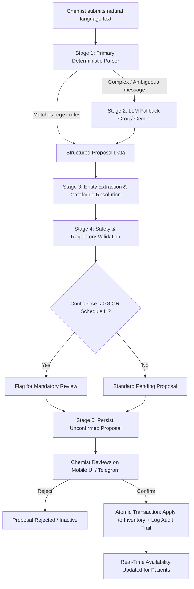

# MediBridge 💊
### Connecting Patients to Nearby Pharmacies Through Smarter Medicine Availability

<p align="center">
  <strong>Find medicines. Verify availability. Make access simpler.</strong>
</p>

<p align="center">
  
  
  
  
  
  
  
</p>

---

## 🌐 Overview

**MediBridge** is a hyper-local pharmacy connectivity and medicine availability platform designed to bridge the communication gap between patients and local pharmacies.

Finding essential medicines during acute needs is frequently frustrating: patients call multiple stores, travel between locations, or rely on outdated, unverified stock listings. Simultaneously, busy retail chemists lack the time for complicated inventory management software.

MediBridge addresses this problem with a unified, 4-tier platform:
1. **Patients** discover real-time medicine availability at nearby verified pharmacies, check stock freshness, and find composition-matched generic substitutes.
2. **Chemists** update stock effortlessly using natural-language messages (English, Hindi, and Hinglish) processed by an intelligent 5-stage NLP/LLM pipeline.
3. **Safety First**: Every AI-interpreted stock update is strictly treated as an unconfirmed **proposal**. No database mutation occurs without explicit verification and confirmation by an authorized chemist (Human-in-the-Loop).

> **Core System Guarantee:** An interpreted message is a proposal, not proof of stock. Confirmed inventory changes require explicit human authorization and produce an immutable, single-step rollback audit trail.

---

## 🚨 The Problem

- **Uncertain Local Availability:** Patients frequently visit multiple stores without knowing whether their medicine is in stock.
- **Time-Critical Search Friction:** Frantic phone calls and physical searches delay treatment during medical emergencies.
- **Complex Inventory Workflows:** Independent pharmacy staff find enterprise ERP/inventory software tedious to operate during peak retail hours.
- **Outdated Stock Information:** Stale, unconfirmed online listings mislead patients.
- **Lack of Generic Transparency:** Patients often struggle to find safe, approved generic brand alternatives when their prescribed brand is out of stock.

---

## 💡 Our Solution

MediBridge creates a seamless, verified loop between patient discovery and pharmacy stock management:

* 🔎 **Intelligent Medicine Search:** Search catalogue medicines by brand names, generic active salts, or colloquial Hinglish aliases.
* 📍 **Geospatial Pharmacy Discovery:** Haversine distance-calculated store discovery filtered by active stock and 24-hour freshness indicators.
* 🤖 **Hybrid AI/LLM Stock Parser:** Natural language comprehension combining ultra-fast deterministic regex parsing with structured Groq / Google Gemini LLM fallback.
* 🛡️ **Strict Human-in-the-Loop:** Unconfirmed stock proposals (`PENDING`) require explicit chemist confirmation before inventory balances update.
* 📋 **Immutable Audit Trail & Undo:** Atomic transactional history logging with single-step rollback protection against accidental updates.
* 💊 **Composition-Matched Substitutes:** Instant generic alternative recommendations matching chemical composition, strength, and dosage form.
* 📱 **Multi-Channel Interfaces:** Modern responsive mobile web application (Google Stitch design), dual-mode Telegram bot, and Streamlit operational dashboard.

---

## ⚙️ How It Works

### The 5-Stage AI/LLM Stock Proposal Pipeline



### Natural Language Example

A chemist messages:
> *"Dolo 650 ke 20 strips available hain"*

1. **Parser Execution:** The parser isolates the medicine name (`Dolo`), dosage strength (`650mg`), and package quantity (`20 strips`), strictly distinguishing medicine strength from inventory quantity.
2. **Catalogue Resolution:** Resolves against catalogue entry ID `1` (`Dolo 650`, Generic: `Paracetamol`, Strength: `650mg`, Form: `tablet`).
3. **Safety Check:** Evaluates Schedule H prescription status and parser confidence score (e.g., `0.95`).
4. **Proposal Creation:** Generates a `PENDING` proposal with a 24-hour expiration timestamp. **Inventory remains untouched.**
5. **Chemist Confirmation:** The chemist reviews the card on the mobile web app or Telegram bot and taps **Confirm**. The inventory updates atomically and an immutable history row is recorded.

---

## 🏗️ Technical Architecture

MediBridge is engineered with a strict 4-tier separation of concerns:

```
┌────────────────────────────────────────────────────────────────────────┐
│                        1. USER INTERFACE TIER                          │
│                                                                        │
│    ┌───────────────────────────┐      ┌───────────────────────────┐    │
│    │  Patient Mobile Web App   │      │  Chemist Mobile Web App   │    │
│    │  - Real-Time Search       │      │  - Conversational NLP     │    │
│    │  - Nearby Pharmacy Map    │      │  - Proposal Verification  │    │
│    │  - Substitute Discovery   │      │  - Store Inventory & Undo │    │
│    └─────────────┬─────────────┘      └─────────────┬─────────────┘    │
│                  │                                  │                  │
│    ┌─────────────┴─────────────┐      ┌─────────────┴─────────────┐    │
│    │   Telegram Bot (bot.py)   │      │ Streamlit Dashboard (GUI) │    │
│    │   Dual-Mode Bot Interface │      │ Inventory, Logs, Proposals│    │
│    └─────────────┬─────────────┘      └─────────────┬─────────────┘    │
│                  └─────────────────┬────────────────┘                  │
└────────────────────────────────────┼───────────────────────────────────┘
                                     │ JSON over HTTP (CORS-enabled)
┌────────────────────────────────────▼───────────────────────────────────┐
│                       2. REST API GATEWAY TIER                         │
│                                                                        │
│    FastAPI Application (`api/main.py`)                                 │
│    - 23 REST Endpoints with Pydantic v2 Schema Validation              │
│    - Haversine Geolocation Distance Calculation (0.5 - 50 km)          │
│    - Server-Side Pharmacy Scoping & Authorization (HTTP 403)           │
│    - Static File Mounting (/app) for Mobile Web Client                 │
└────────────────────────────────────┬───────────────────────────────────┘
                                     │ Pure Python Invocations
┌────────────────────────────────────▼───────────────────────────────────┐
│                          3. SERVICE LAYER                              │
│                                                                        │
│    ┌───────────────────┐  ┌───────────────────┐  ┌───────────────────┐ │
│    │  Proposal Service │  │Confirmation Service│ │  History Service  │ │
│    │ (process_stock_   │  │(confirm_and_apply_ │ │ (orchestrate_undo)│ │
│    │      message)     │  │     proposal)      │ │                   │ │
│    └─────────┬─────────┘  └─────────┬─────────┘  └─────────┬─────────┘ │
│              │                      │                      │           │
│    ┌─────────┴─────────┐  ┌─────────┴─────────┐            │           │
│    │  AI Parser Engine │  │ Proposal Adapter  │            │           │
│    │  - Regex Primary  │  │ - Confidence Badge│            │           │
│    │  - Groq/Gemini LLM│  │ - Schedule H Alert│            │           │
│    └───────────────────┘  └───────────────────┘            │           │
│              │                                             │           │
│    ┌─────────┴─────────┐  ┌────────────────────────────────┴─────────┐ │
│    │ Catalogue Service │  │ Operations Adapter (DBOperationsAdapter) │ │
│    │ - Composition Match│  │ Transaction Boundary & Timestamp Control │ │
│    └───────────────────┘  └────────────────────────────────┬─────────┘ │
└────────────────────────────────────────────────────────────┼───────────┘
                                                             │ SQLAlchemy 2.0
┌────────────────────────────────────────────────────────────▼───────────┐
│                         4. DATA PERSISTENCE TIER                       │
│                                                                        │
│    Relational Schema: `medibridge_db/models.py` (11 Relational Tables) │
│    Data Operations:   `medibridge_db/operations.py` (23 Pure Functions)│
│    Storage Engine:    SQLite with Write-Ahead Logging (WAL)            │
│                       Enforced Foreign Keys (`PRAGMA foreign_keys=ON`) │
└────────────────────────────────────────────────────────────────────────┘
```

---

## 🛡️ Safety & Regulatory Integrity

Medicine data demands rigorous safety standards. MediBridge enforces non-negotiable architectural guardrails:

* **No Direct AI Writes:** The AI parser produces proposals only. Unconfirmed proposals cannot alter confirmed stock.
* **Strict Human Confirmation:** Inventory mutations execute exclusively after explicit human authorization.
* **Pharmacy-Scoped Access Control:** State-mutating endpoints verify that `chemist_user_id` holds active employment at the targeted `pharmacy_id` (HTTP 403 Forbidden on violation).
* **24-Hour Expiration:** Stock proposals automatically expire after 24 hours. Expired proposals cannot be applied.
* **Prescription Drug (Schedule H) Safeguards:** Controlled drugs are automatically flagged with high-visibility safety alerts requiring pharmacist verification.
* **Immutable Audit Trail:** Stock updates produce append-only history records containing previous quantity, new quantity, chemist ID, and timestamp.
* **Protected Single-Step Rollback (Undo):**
  - An `UNDO` record cannot itself be undone.
  - A historical change cannot be undone more than once.
  - If a newer change exists for the same inventory row, older changes are protected from rollback until newer ones are reversed.
* **Freshness Transparency:** Inventories confirmed > 24 hours ago are visually flagged (`is_stale = true`), eliminating misleading live guarantees.

---

## ✨ Key Features & User Interfaces

### 1. Patient Experience (Public Discovery)
* **Real-Time Medicine Search:** Search all 25 catalogue medicines by brand, generic salt, or registered alias.
* **Nearby Pharmacy Geolocation:** Find open pharmacies sorted by physical Haversine distance with interactive radius filtering.
* **Stock Freshness Badges:** Clear availability states (`IN_STOCK`, `LOW_STOCK`, `OUT_OF_STOCK`) with exact confirmation timestamps.
* **Substitute Explorer:** Automatic composition-based alternatives matching active salts (e.g., finding Calpol, Crocin, or Dolo for Paracetamol 650mg).

### 2. Chemist Experience (Inventory Operations)
* **Natural Language Stock Updates:** Free-text submissions in English, Hindi, and Hinglish.
* **Verification Cards:** Review parsed medicine name, strength, proposed quantity change, and confidence score before confirming.
* **Pharmacy Inventory Tracker:** Live stock table with stock status indicators and staleness alerts.
* **One-Click Audit & Undo:** Complete history of stock movements with immediate single-step undo.

### 3. Client Interfaces
* **Mobile Web App (`/app`):** Built with Google Stitch design principles (responsive, mobile ergonomics, clean typography, bottom navigation, instant role switching).
* **Telegram Bot (`bot.py`):** Interactive conversational bot supporting patient search and chemist inventory management.
* **Streamlit Dashboard (`dashboard.py`):** Administrative and chemist command center for multi-pharmacy inventory and audit exploration.

---

## 🛠️ Technology Stack

| Layer | Technologies |
|---|---|
| **Frontend UI** | HTML5, Modern CSS (Stitch Design System), Vanilla JavaScript (Zero Build Step), Streamlit, Python-Telegram-Bot |
| **API Gateway** | FastAPI, Uvicorn, Pydantic v2, CORS Middleware |
| **AI & NLP** | Hybrid Architecture: Deterministic RegEx Primary Parser + Groq (Llama 3) / Google Gemini API Fallback |
| **Service Layer** | Python 3.10+, Repository Adapter Pattern (`DBOperationsAdapter`, `ProposalAdapter`) |
| **Database & ORM** | SQLAlchemy 2.0, SQLite 3 (WAL Mode, Immediate Transactions, Foreign Key PRAGMA) |
| **Testing** | pytest, FastAPI TestClient, httpx |
| **DevOps & Versioning**| Git, GitHub, Python Virtual Environments (`.venv`) |

---

## 📁 Repository Structure

```text
medidoc/
├── api/                             # FastAPI REST Gateway
│   ├── __init__.py
│   └── main.py                      # 23 REST Endpoints, CORS, /app static mount
├── docs/                            # Architectural & Specification Docs
│   ├── APP_REQUIREMENTS.md          # Dual role requirements & NFRs
│   ├── architecture.md              # 4-tier architecture & sequence diagrams
│   ├── COMPLETION_REPORT.md         # Verification report & phase milestones
│   ├── CONTRACT.md                  # Service layer API contracts
│   ├── IMPLEMENTATION_PLAN.md       # Implementation roadmap
│   ├── MIGRATION_MAP.md             # Prototype-to-mobile mapping
│   ├── prd.md                       # Product requirements document
│   └── rules.md                     # Business rules & safety constraints
├── medibridge_db/                   # Database Persistence Tier
│   ├── models.py                    # 11 SQLAlchemy 2.0 ORM Models
│   └── operations.py                # 23 Pure Database Operations Functions
├── src/medibridge/                  # Core Business Logic & Services
│   ├── schemas/                     # Pydantic v2 Validation Schemas
│   │   ├── search.py                # Medicine & pharmacy search schemas
│   │   └── stock.py                 # Stock proposals & inventory schemas
│   └── services/                    # Business Rule Orchestration
│       ├── ai_parser.py             # 5-stage deterministic + LLM parser
│       ├── catalogue_service.py     # Substitute discovery & catalogue search
│       ├── confirmation_service.py  # Proposal confirmation & stock application
│       ├── history_service.py       # Audit trail & single-step undo engine
│       ├── persistence.py           # Session management & transaction control
│       ├── proposal_adapter.py      # Confidence scoring & review flagging
│       └── proposal_service.py      # Proposal creation & scoping checks
├── static/                          # Google Stitch Mobile Web Client
│   ├── app.js                       # Client-side controller & API client
│   ├── index.html                   # 7-view responsive mobile UI
│   └── styles.css                   # Stitch design system color tokens & cards
├── tests/                           # Comprehensive Test Suite (276 Tests)
│   ├── test_ai_parser.py            # NLP parsing tests
│   ├── test_api.py                  # REST API gateway tests
│   ├── test_catalogue_service.py    # Search & substitute matching tests
│   ├── test_confirmation_service.py # Confirmation workflow tests
│   ├── test_database.py             # Connection & session tests
│   ├── test_e2e_workflow.py         # End-to-end propose-confirm-undo tests
│   ├── test_history_service.py      # History immutability & undo tests
│   ├── test_llm_parser.py           # LLM fallback integration tests
│   ├── test_models.py               # SQLAlchemy ORM model tests
│   ├── test_operations.py           # Database operations tests
│   ├── test_operations_adapter.py   # Repository adapter tests
│   ├── test_persistence.py          # SQLite WAL persistence tests
│   ├── test_proposal_adapter.py     # Proposal record tests
│   ├── test_proposal_service.py     # Proposal lifecycle tests
│   ├── test_schemas.py              # Pydantic schema validation tests
│   ├── test_seed.py                 # Initial seed verification tests
│   ├── test_sqlite_repository.py    # Repository pattern tests
│   └── test_ui_integration.py       # Mobile frontend integration tests
├── bot.py                           # Telegram Bot Interface
├── dashboard.py                     # Streamlit Operational Dashboard
├── medibridge.db                    # SQLite Database (WAL mode)
├── pyproject.toml                   # Project configuration & pytest settings
├── requirements.txt                 # Python dependencies
└── README.md                        # Project documentation
```

---

## 📡 REST API Quick Reference

| Method | Endpoint | Description | Access |
|---|---|---|---|
| `GET` | `/api/health` | Service health & database connectivity check | Public |
| `GET` | `/api/medicines/` | List all 25 verified catalogue medicines | Public |
| `GET` | `/api/medicines/search?q={query}` | Search medicines by brand, generic, or alias | Public |
| `GET` | `/api/medicines/{id}` | Detailed medicine card & dosage information | Public |
| `GET` | `/api/medicines/{id}/substitutes` | Therapeutic alternatives matching composition | Public |
| `GET` | `/api/pharmacies/nearby` | Haversine distance-filtered pharmacy discovery | Public |
| `GET` | `/api/pharmacies/{id}/inventory` | Live store inventory with freshness flags | Public |
| `GET` | `/api/users/{user_id}/pharmacies` | Chemist-authorized store affiliations | Chemist |
| `POST`| `/api/proposals` | Submit natural-language stock update | Chemist |
| `GET` | `/api/pharmacies/{id}/proposals` | View active unconfirmed proposals | Chemist |
| `POST`| `/api/proposals/{id}/confirm` | Verify and apply proposal to inventory | Chemist |
| `POST`| `/api/proposals/{id}/reject` | Reject inaccurate stock proposal | Chemist |
| `GET` | `/api/pharmacies/{id}/history` | Append-only store audit trail | Chemist |
| `POST`| `/api/history/{id}/undo` | Execute single-step rollback on stock change | Chemist |
| `POST`| `/api/substitutions/approve` | Pharmacist regulatory approval for substitute | Pharmacist |

---

## 🚀 Getting Started

### Prerequisites

* **Python 3.10** or higher
* **Git**
* Modern Web Browser (Chrome, Safari, Firefox, Edge)

### 1. Clone the Repository

```bash
git clone https://github.com/Shubhansh013/MediBridge.git
cd MediBridge
```

### 2. Set Up a Virtual Environment

**Windows (PowerShell):**
```powershell
python -m venv .venv
.\.venv\Scripts\Activate.ps1
```

**macOS / Linux:**
```bash
python3 -m venv .venv
source .venv/bin/activate
```

### 3. Install Dependencies

```bash
python -m pip install --upgrade pip
pip install -r requirements.txt
```

### 4. Configure Environment Variables (Optional)

Create a `.env` file in the root directory (refer to `.env.example`):

```ini
# Optional: LLM Fallback API Keys (Primary parser operates offline without keys)
GROQ_API_KEY=your_groq_api_key_here
GEMINI_API_KEY=your_gemini_api_key_here

# Optional: Telegram Bot Token (for bot.py)
TELEGRAM_BOT_TOKEN=your_telegram_bot_token_here
```

---

## 🏃 Running the Application

### Option A: Run the FastAPI Server & Mobile Web App (Recommended)

Start the REST API Gateway:

```bash
python -m uvicorn api.main:app --host 127.0.0.1 --port 8000 --reload
```

* **Interactive Mobile Web Client:** Open [http://127.0.0.1:8000/app](http://127.0.0.1:8000/app) in your desktop browser or mobile emulator.
* **Interactive OpenAPI Docs (Swagger UI):** Open [http://127.0.0.1:8000/docs](http://127.0.0.1:8000/docs).
* **System Health Endpoint:** Open [http://127.0.0.1:8000/api/health](http://127.0.0.1:8000/api/health).

### Option B: Run the Telegram Bot

```bash
python bot.py
```

### Option C: Run the Streamlit Dashboard

```bash
streamlit run dashboard.py
```

---

## 🧪 Testing & Verification

MediBridge includes an automated test suite with **276 unit and integration tests** verifying all schemas, ORM models, pure database operations, service orchestration, NLP parsing, and REST endpoints.

Run the entire test suite:

```bash
pytest
```

Run test suite with concise output:

```bash
pytest -q
```

Run API endpoint tests only:

```bash
pytest tests/test_api.py -v
```

---

## 🗺️ Project Milestones & Roadmap

- [x] **Phase 1: Database Persistence Tier:** 11 relational tables, SQLite WAL mode, and 23 operations functions.
- [x] **Phase 2: Service Layer & Business Rules:** Proposal, confirmation, history, and catalogue services.
- [x] **Phase 3: Hybrid NLP & LLM Parser:** Deterministic English/Hindi/Hinglish parser with Groq/Gemini fallback.
- [x] **Phase 4: Safety & Verification Engine:** Human-in-the-loop confirmation, 24h expiration, and single-step undo.
- [x] **Phase 5: REST API Gateway:** 23 endpoints in FastAPI with CORS and Pydantic validation.
- [x] **Phase 6: Mobile Web Client:** Responsive Google Stitch UI serving patient discovery and chemist workflows at `/app`.
- [x] **Phase 7: Full Test Coverage:** 276 passing automated tests with zero regressions.
- [ ] **Phase 8: Post-Hackathon Extensions:**
  - WhatsApp Business API integration for chemist stock updates.
  - Multi-city pharmacy onboarding and verification registry.
  - Optical Character Recognition (OCR) for handwritten doctor prescriptions.
  - Real-time WebSocket notifications for low-stock alerts.

---

## 👥 Contributors

MediBridge is developed collaboratively by the **MediBridge Hackathon Team**:
* **Backend Architecture & API Gateway**
* **Database Design & Relational Persistence**
* **AI / NLP Parsing & Prompt Engineering**
* **Frontend Mobile UX & Interactive Dashboards**

---

## 📄 License

This project is licensed under the MIT License — see the LICENSE file for details.

---

<p align="center">
  <strong>MediBridge — Making medicine availability simpler, transparent, and verified.</strong>
  <br />
  <sub>Built with care for patients and community pharmacies.</sub>
</p>
