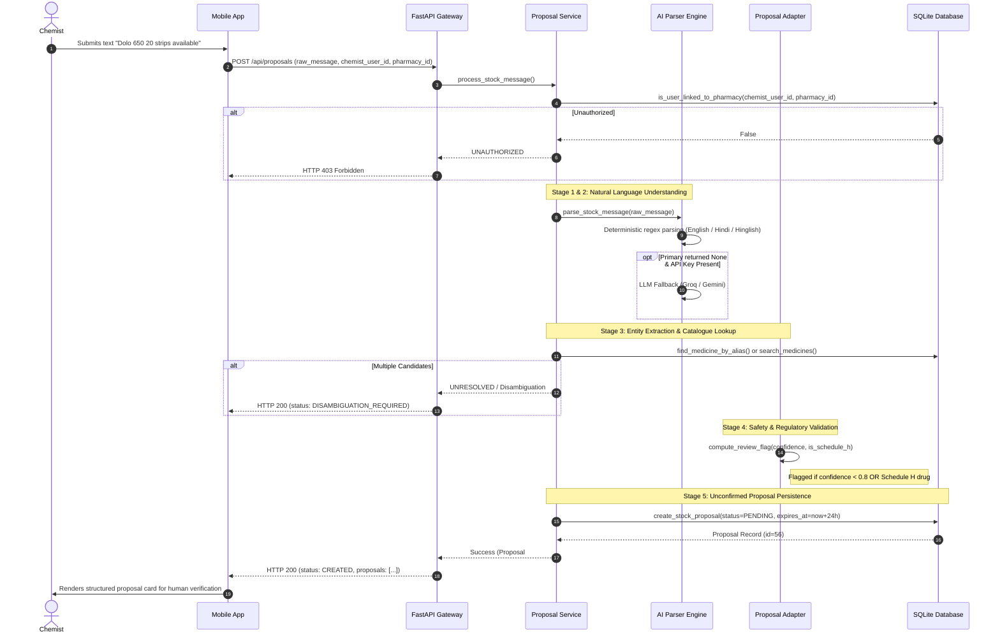
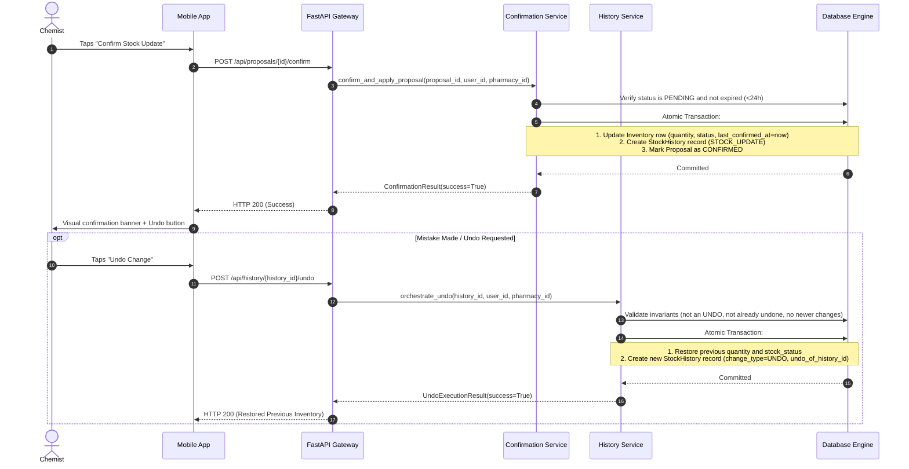

# MediBridge Technical Architecture: End-to-End Mobile & Backend Specification

**Version:** 2.0  
**Date:** 2026-10-25  
**Document Status:** Production Reference  

---

## 1. High-Level 4-Tier Topology

MediBridge enforces a clean separation of concerns across four connected tiers:

```
┌────────────────────────────────────────────────────────────────────────┐
│                        1. USER INTERFACE TIER                          │
│                                                                        │
│    ┌───────────────────────────┐      ┌───────────────────────────┐    │
│    │  Patient Mobile View      │      │  Chemist Mobile View      │    │
│    │  - Search & Discovery     │      │  - Conversational NLP     │    │
│    │  - Geo Nearby Pharmacies  │      │  - Proposal Confirmation  │    │
│    │  - Substitute Alternatives│      │  - Stock Audit & Undo     │    │
│    └─────────────┬─────────────┘      └─────────────┬─────────────┘    │
│                  │                                  │                  │
│                  └─────────────────┬────────────────┘                  │
└────────────────────────────────────┼───────────────────────────────────┘
                                     │ JSON over HTTPS (CORS-enabled)
┌────────────────────────────────────▼───────────────────────────────────┐
│                       2. REST API GATEWAY TIER                         │
│                                                                        │
│    FastAPI Application (`api/main.py`)                                 │
│    - Route Dispatching, CORS Middleware & Error Normalization          │
│    - Endpoint Validation via Pydantic Schemas                          │
│    - Geolocation Haversine Distance Computation                        │
│    - Server-side User & Pharmacy Scoping Authorization                 │
└────────────────────────────────────┬───────────────────────────────────┘
                                     │ Pure Python Function Invocations
┌────────────────────────────────────▼───────────────────────────────────┐
│                          3. SERVICE LAYER                              │
│                                                                        │
│    ┌───────────────────┐  ┌───────────────────┐  ┌───────────────────┐ │
│    │  Proposal Service │  │Confirmation Service│ │  History Service  │ │
│    │ (process_stock_   │  │(confirm_and_apply_ │ │ (orchestrate_undo)│ │
│    │      message)     │  │     proposal)      │ │                   │ │
│    └─────────┬─────────┘  └─────────┬─────────┘  └─────────┬─────────┘ │
│              │                      │                      │           │
│    ┌─────────┴─────────┐  ┌─────────┴─────────┐            │           │
│    │  AI Parser Engine │  │ Proposal Adapter  │            │           │
│    │ (Deterministic &  │  │(compute_review_   │            │           │
│    │   LLM Fallback)   │  │      flag)        │            │           │
│    └───────────────────┘  └───────────────────┘            │           │
│                                                            │           │
│    ┌───────────────────────────────────────────────────────┴─────────┐ │
│    │  Operations Adapter (`DBOperationsAdapter`)                     │ │
│    │  Transaction Boundary Management, UTC Timestamp Enforcement     │ │
│    └────────────────────────────────┬────────────────────────────────┘ │
└─────────────────────────────────────┼──────────────────────────────────┘
                                      │ SQLAlchemy 2.0 ORM & Operations
┌─────────────────────────────────────▼──────────────────────────────────┐
│                         4. DATA PERSISTENCE TIER                       │
│                                                                        │
│    Pure Data Access: `medibridge_db/operations.py` (23 Functions)      │
│    Relational Models: `medibridge_db/models.py` (11 Relational Tables) │
│    Storage Engine: SQLite with WAL Mode & Foreign Keys (`PRAGMA`)      │
└────────────────────────────────────────────────────────────────────────┘
```

---

## 2. 5-Stage AI / NLP Processing Pipeline

Chemist inventory updates follow an immutable 5-stage human-in-the-loop pipeline:



---

## 3. Human-in-the-Loop Confirmation & Undo Sequence



---

## 4. Security & Isolation Boundaries

1. **Server-Side Authorization**: Every state-mutating endpoint independently validates that `chemist_user_id` holds active employment at `pharmacy_id`.
2. **Transaction Integrity**: Inventory mutations occur exclusively inside explicit ACID transaction boundaries in `DBOperationsAdapter`. Unhandled errors automatically invoke rollback.
3. **No Direct Frontend-DB Link**: The mobile client has zero direct database connectivity or credentials.
4. **Zero Live Placeholder Leakage**: All values displayed in live flows originate from API payloads.
