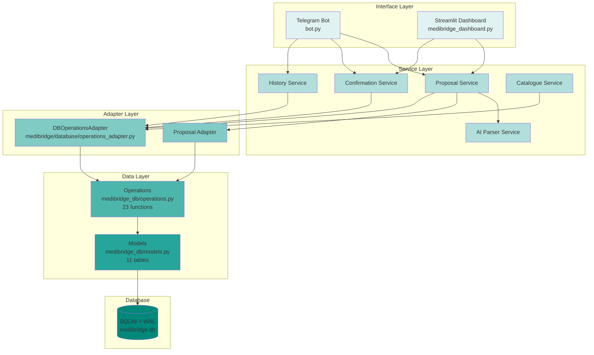
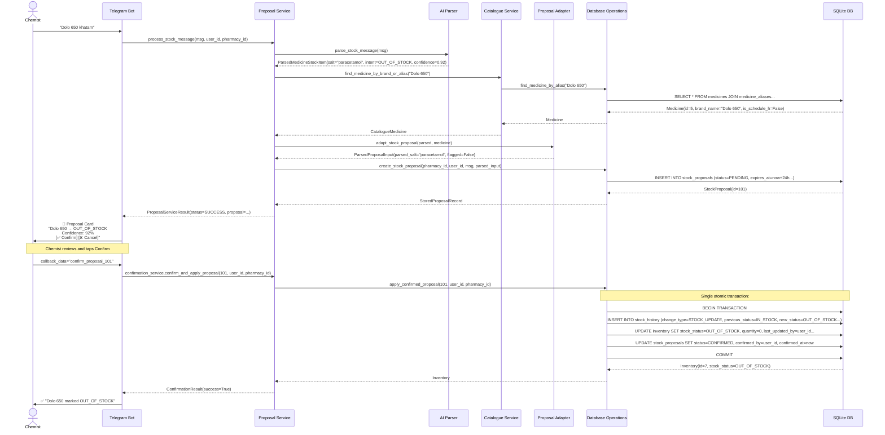
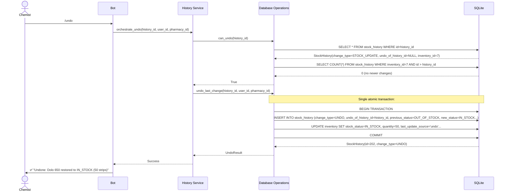
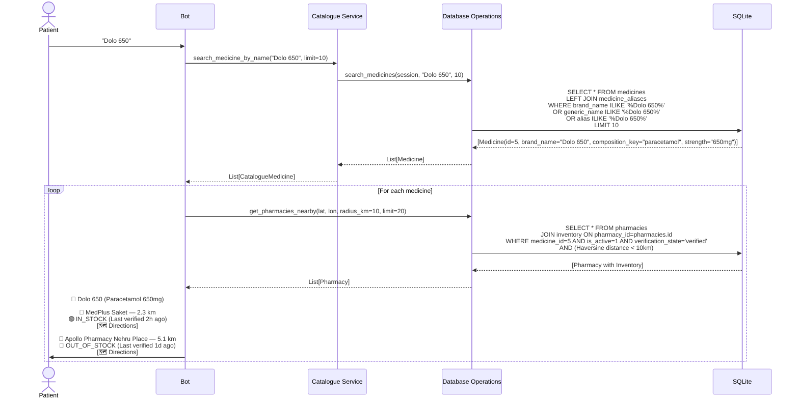

# MediBridge Technical Architecture

**Version:** 1.0  
**Date:** 2026-10-24  
**Status:** Implemented (Backend Foundation Complete)

---

## 1. System Overview

MediBridge is a three-tier pharmacy connectivity platform built with Python, SQLite, and Telegram/Streamlit interfaces. The architecture enforces separation between UI layers, business logic, and data persistence to ensure maintainability and testability.



**Key Principles:**
1. **Single source of truth**: Database contract (`docs/CONTRACT.md`) defines all interfaces
2. **No business logic in database layer**: Operations are pure data access; authorization and validation handled by service layer
3. **Pharmacy-scoped isolation**: Every mutation verifies user-pharmacy link
4. **Human-verified updates**: AI proposes, humans confirm
5. **Immutable audit trail**: History append-only, undo recorded as new entry

---

## 2. Directory Structure

```
medidoc/
├── medibridge_db/              # Database layer (Member 1)
│   ├── __init__.py             # Package exports
│   ├── config.py               # DB URL, test URL, stale threshold
│   ├── database.py             # Engine, session factory, Base class
│   ├── models.py               # 11 SQLAlchemy 2.0 models
│   ├── operations.py           # 23 data access functions
│   ├── exceptions.py           # 9 custom exceptions
│   ├── normalize.py            # Composition key normalization
│   └── seed.py                 # Realistic seed data (12 pharmacies, 50+ medicines)
│
├── src/medibridge/             # Service layer
│   ├── schemas/                # Pydantic validation schemas
│   │   ├── stock.py            # StockUpdateProposal, ParsedMedicineStockItem
│   │   └── search.py           # Search request/response models
│   ├── services/               # Business logic orchestration
│   │   ├── ai_parser.py        # Deterministic NLP parser (English, Hindi, Hinglish)
│   │   ├── proposal_service.py # Parse → catalogue → propose workflow
│   │   ├── confirmation_service.py # Confirm → apply atomic transaction
│   │   ├── history_service.py  # Undo orchestration
│   │   ├── catalogue_service.py # Medicine search and substitutes
│   │   └── proposal_adapter.py # Schema conversion service↔DB
│   ├── database/               # Adapter layer
│   │   └── operations_adapter.py # Repository pattern wrapping operations.py
│   └── exceptions/             # Service-layer exceptions
│
├── tests/                      # 100+ tests (pytest)
│   ├── test_ai_parser.py       # Parser unit tests (24 tests)
│   ├── test_schemas.py         # Pydantic validation tests
│   ├── test_models.py          # SQLAlchemy model tests
│   ├── test_operations.py      # Database operations tests
│   ├── test_proposal_service.py # Service orchestration tests
│   ├── test_confirmation_service.py
│   ├── test_history_service.py
│   ├── test_catalogue_service.py
│   ├── test_e2e_workflow.py    # End-to-end integration tests
│   ├── test_operations_adapter.py
│   ├── test_proposal_adapter.py
│   ├── test_sqlite_repository.py
│   ├── test_ui_integration.py
│   ├── test_persistence.py
│   ├── test_seed.py
│   ├── test_database.py        # Connection, WAL, FK enforcement
│   └── conftest.py             # Shared fixtures
│
├── bot.py                      # Telegram bot interface (Member 3)
├── medibridge_dashboard.py     # Streamlit dashboard (Member 4)
├── dashboard.py                # Alternative dashboard entry point
├── mock_db.py                  # Demo database initialization
│
├── docs/                       # Documentation
│   ├── CONTRACT.md             # Database contract (frozen)
│   ├── STATUS.md               # Implementation status report
│   ├── prd.md                  # Product requirements (this session)
│   ├── architecture.md         # Technical architecture (this document)
│   ├── rules.md                # Business rules (pending)
│   ├── integration.md          # Integration guide (pending)
│   └── deployment.md           # Deployment guide (pending)
│
├── requirements.txt            # Python dependencies
├── .env.example                # Environment variables template
├── SCHEMA_CHANGELOG.md         # Schema version history
└── README.md                   # Project overview
```

---

## 3. Component Architecture

### 3.1 Database Layer (`medibridge_db/`)

**Responsibility:** Pure data access. No authorization, no business logic.

#### 3.1.1 Database Configuration (`config.py`)
- `get_db_url()`: Returns SQLite connection string (default: `sqlite:///./data/medibridge.db`)
- `get_test_db_url()`: In-memory database for tests
- `get_stale_threshold_hours()`: Configurable staleness threshold (default: 24h)

#### 3.1.2 Database Engine (`database.py`)
```python
# SQLite optimizations
- WAL mode (concurrent reads + single writer)
- PRAGMA foreign_keys = ON
- PRAGMA busy_timeout = 5000ms
- Session factory with automatic commit/rollback
- UTCDateTime type (timezone-aware)
```

#### 3.1.3 Models (`models.py`) — 11 Tables

| Table | Primary Key | Purpose | Key Relationships |
|-------|-------------|---------|-------------------|
| `pharmacies` | id (AUTOINCREMENT) | Verified pharmacy locations with Telegram chat mapping | → inventory, proposals, history, substitution_approvals, user_pharmacies |
| `users` | id (AUTOINCREMENT) | Telegram users with roles (patient/chemist/pharmacist/admin) | → proposals, history, substitution_approvals, user_pharmacies |
| `user_pharmacies` | (user_id, pharmacy_id) | M:M staff membership with role_at_pharmacy | ← users, pharmacies |
| `medicines` | id (AUTOINCREMENT) | Brand-level catalogue with composition_key normalization | → inventory, aliases, substitution_approvals |
| `medicine_aliases` | id (AUTOINCREMENT) | Fuzzy matching (misspellings, Hinglish, short names) | ← medicines (CASCADE on delete) |
| `inventory` | id (AUTOINCREMENT) | Pharmacy × medicine stock with UNIQUE(pharmacy_id, medicine_id) | ← pharmacies, medicines; → history |
| `stock_proposals` | id (AUTOINCREMENT) | AI-parsed pending updates with 24h expiry | ← pharmacies, users; → history |
| `stock_history` | id (AUTOINCREMENT) | Immutable audit trail (STOCK_UPDATE + UNDO entries) | ← inventory, pharmacies, medicines, users, proposals |
| `substitution_approvals` | id (AUTOINCREMENT) | Per-request pharmacist substitute approvals | ← pharmacies, medicines (2×), users |
| `sos_broadcasts` | id (AUTOINCREMENT) | **OPTIONAL** Patient SOS requests | ← users, medicines; → sos_responses |
| `sos_responses` | id (AUTOINCREMENT) | **OPTIONAL** Chemist SOS replies | ← sos_broadcasts, pharmacies, users |

**Key Constraints:**
- UNIQUE: `(brand_name, composition_key, strength, form, manufacturer)` on medicines
- UNIQUE: `(pharmacy_id, medicine_id)` on inventory (one stock record per pharmacy×medicine)
- UNIQUE: `undo_of_history_id` on stock_history (prevents double-undo at DB level)
- UNIQUE: `telegram_chat_id` on pharmacies, `telegram_user_id` on users, `alias` on medicine_aliases
- CHECK: `quantity >= 0` on inventory, proposals, history
- CHECK: Stock status consistency (OUT_OF_STOCK → qty=0/NULL; IN_STOCK/LOW_STOCK → qty>0/NULL)
- CHECK: Latitude [-90, 90], Longitude [-180, 180]
- INDEX: `(composition_key, strength, form)` on medicines for substitute lookup
- INDEX: `expires_at` on stock_proposals for cron expiry job
- INDEX: `last_confirmed_at` on inventory for staleness queries

#### 3.1.4 Operations (`operations.py`) — 23 Functions

**Inventory Reads (5 functions):**
- `get_pharmacies_nearby(session, lat, lon, radius_km, limit)` → List[Pharmacy]  
  Haversine distance filter; only active + verified pharmacies
- `get_inventory_for_medicine(session, pharmacy_id, medicine_id, include_stale)` → Optional[Inventory]
- `get_pharmacy_inventory(session, pharmacy_id, include_stale, status_filter)` → List[Inventory]
- `get_substitutes_for_medicine(session, medicine_id, pharmacy_id)` → List[Medicine]  
  Same composition_key + strength + form
- `get_stale_inventory(session, pharmacy_id, threshold_hours)` → List[Inventory]  
  For cron job: `datetime.utcnow() - last_confirmed_at > threshold`

**Medicine Lookup (3 functions):**
- `find_medicine_by_alias(session, alias)` → Optional[Medicine]
- `search_medicines(session, query, limit)` → List[Medicine]  
  ILIKE on brand_name, generic_name, aliases
- `get_medicine_by_id(session, medicine_id)` → Optional[Medicine]

**Proposals (5 functions):**
- `create_stock_proposal(session, pharmacy_id, chemist_user_id, raw_message, parsed)` → StockProposal  
  Sets `expires_at = created_at + 24h`, verifies user-pharmacy link
- `get_proposal_by_id(session, proposal_id)` → Optional[StockProposal]
- `list_pending_proposals(session, pharmacy_id, flagged_only, limit)` → List[StockProposal]  
  Filters `status=PENDING` AND `datetime.utcnow() < expires_at`
- `expire_overdue_proposals(session, cutoff)` → int (count updated)  
  Idempotent cron job: `PENDING → EXPIRED` where `expires_at < cutoff`
- `renew_proposal(session, expired_proposal_id, chemist_user_id, raw_message, parsed)` → StockProposal  
  Creates NEW proposal with `renewed_from_id`

**Apply Confirmed Proposal (1 function):**
- `apply_confirmed_proposal(session, proposal_id, confirmed_by_user_id, pharmacy_id)` → Inventory  
  **Single atomic transaction:**
  1. Verify `status=CONFIRMED`, `expires_at > utcnow()`, pharmacy_id matches, user linked
  2. Create `stock_history` row (change_type=STOCK_UPDATE, previous/new values)
  3. Update `inventory` (stock_status, quantity, last_confirmed_at, last_updated_by, last_update_source='proposal_apply')
  4. Mark proposal `confirmed_by`, `confirmed_at`

**History Reads (3 functions):**
- `get_inventory_history(session, inventory_id, limit)` → List[StockHistory]
- `get_pharmacy_history(session, pharmacy_id, limit)` → List[StockHistory]
- `get_user_history(session, user_id, limit)` → List[StockHistory]

**Undo (2 functions):**
- `undo_last_change(session, history_id, undone_by_user_id, pharmacy_id)` → StockHistory  
  **Single atomic transaction:**
  1. Load target history row
  2. Verify `change_type=STOCK_UPDATE` (not UNDO)
  3. Verify `undo_of_history_id IS NULL` (not already undone)
  4. Verify no newer history row for same inventory (`id > target.id`)
  5. Verify pharmacy_id matches, user linked
  6. Create undo history row (change_type=UNDO, undo_of_history_id=target.id, previous=current, new=target.previous)
  7. Restore inventory to target.previous values
- `can_undo(session, history_id)` → bool  
  Checks undo constraints without modifying

**Substitution Approvals (2 functions):**
- `record_substitution_approval(session, pharmacy_id, requested_medicine_id, substitute_medicine_id, approving_pharmacist_id, status, request_reference)` → SubstitutionApproval  
  Verifies same composition_key + strength + form; no reuse of old approvals
- `get_substitution_approvals(session, pharmacy_id, requested_medicine_id)` → List[SubstitutionApproval]

**Pharmacy Membership (3 functions):**
- `is_user_linked_to_pharmacy(session, user_id, pharmacy_id)` → bool  
  Service layer calls this BEFORE mutating operations
- `get_user_pharmacies(session, user_id)` → List[Pharmacy]
- `get_pharmacy_staff(session, pharmacy_id, role)` → List[User]

#### 3.1.5 Exceptions (`exceptions.py`)
```python
ProposalNotPendingError       # Status != CONFIRMED
ProposalExpiredError          # expires_at < now at apply time
ProposalPharmacyMismatchError # Proposal belongs to different pharmacy
InventoryNotFoundError        # No inventory row for pharmacy×medicine
HistoryAlreadyUndoneError     # undo_of_history_id != NULL
NewerChangeExistsError        # Exists history row with id > target.id
CannotUndoUndoError          # Target change_type = UNDO
StockStatusQuantityMismatchError # OUT_OF_STOCK with qty>0
PharmacyScopeMismatchError    # Record pharmacy_id != passed pharmacy_id
UserNotLinkedToPharmacyError  # No user_pharmacies row
```

#### 3.1.6 Composition Key Normalization (`normalize.py`)
```python
def normalize_composition_key(raw: str) -> str:
    """
    Normalize medicine composition for substitute matching.
    
    Example:
        "Ibuprofen + Paracetamol" → "ibuprofen+paracetamol"
        "Paracetamol+Ibuprofen"   → "ibuprofen+paracetamol"  (sorted)
    
    Algorithm:
        1. Lowercase
        2. Split by "+"
        3. Strip whitespace
        4. Sort alphabetically
        5. Join with "+"
    """
```

#### 3.1.7 Seed Data (`seed.py`)
- 12 pharmacies across Delhi NCR (Saket, Nehru Place, Green Park, Hauz Khas, etc.)
- 50+ medicines (Dolo 650, Crocin, Combiflam, Azithromycin, Amoxicillin, etc.)
- 100+ medicine aliases (Hinglish, misspellings, short names)
- 6 demo users (patients, chemists, pharmacists)
- User-pharmacy links
- Initial inventory (varied stock statuses)

---

### 3.2 Service Layer (`src/medibridge/services/`)

**Responsibility:** Orchestrate workflows, enforce business rules, call database operations.

#### 3.2.1 AI Parser (`ai_parser.py`)

**Deterministic NLP parser** for English, Hindi, and Hinglish stock messages.

**Supported Patterns:**
```python
OUT_OF_STOCK:
  "khatam", "out of stock", "finished", "nahi hai", "stock nahi", 
  "khatam ho gaya", "zero", "खत्म"

IN_STOCK:
  "aaya", "available", "mil gaya", "stock hai", "aa gaya", 
  "in stock", "उपलब्ध"

LOW_STOCK:
  "kam", "low", "thoda", "कम"

Quantity extraction:
  "20 strips", "5 boxes", "100 tablets"
  Distinguishes from medicine strength: "650mg" != "650 strips"

Rejection rules:
  - Uncertain: "shayad", "maybe", "लगता है"
  - Future: "kal", "tomorrow", "aayega"
  - Conversational: "hello", "thanks", "kaise ho"
```

**Returns:** `ParsedMedicineStockItem` (Pydantic schema) or raises validation error

**Design Decision:** Deterministic parser chosen over LLM for:
- Predictable behavior (testable with 24 unit tests)
- Zero API cost
- Sub-100ms latency
- No hallucination risk

**Optional LLM Fallback:** Code exists (`test_llm_parser.py`) but not active. Would use Google Gemini or Groq for complex messages deterministic parser rejects.

#### 3.2.2 Proposal Service (`proposal_service.py`)

**Orchestrates:** Parse → Catalogue Lookup → Adapt → Create Proposal

```python
def process_stock_message(
    raw_message: str,
    chemist_user_id: int,
    pharmacy_id: int,
    catalogue_search: Callable,
    proposal_repository: StockProposalRepositoryProtocol
) -> ProposalServiceResult:
    """
    1. Parse message with ai_parser.parse_stock_message()
    2. Resolve medicine from catalogue (brand match → alias match → generic match)
    3. Adapt parsed item to DB format (proposal_adapter.adapt_stock_proposal)
    4. Compute review flag (confidence < 0.8 OR is_schedule_h)
    5. Create PENDING proposal via repository
    6. Return success/failure result
    """
```

**Result Enum:**
- `SUCCESS`: Proposal created
- `PARSE_ERROR`: Could not interpret message
- `CATALOGUE_NOT_FOUND`: Medicine not in catalogue
- `AUTHORIZATION_ERROR`: User not linked to pharmacy
- `DATABASE_ERROR`: Constraint violation or connection failure

#### 3.2.3 Confirmation Service (`confirmation_service.py`)

**Orchestrates:** Authorize → Apply → Record

```python
def confirm_and_apply_proposal(
    proposal_id: int,
    confirmed_by_user_id: int,
    pharmacy_id: int,
    repository: Callable
) -> ConfirmationResult:
    """
    1. Verify user linked to pharmacy
    2. Call repository.apply_confirmed_proposal (atomic transaction)
    3. Return updated inventory or error
    """

def reject_proposal_workflow(
    proposal_id: int,
    rejected_by_user_id: int,
    rejection_note: Optional[str],
    repository: Callable
) -> ConfirmationResult:
    """
    Marks proposal status=REJECTED, records rejection note
    """
```

#### 3.2.4 History Service (`history_service.py`)

**Orchestrates:** Validate → Undo → Notify

```python
def orchestrate_undo(
    history_id: int,
    undone_by_user_id: int,
    pharmacy_id: int,
    repository: Callable
) -> UndoExecutionResult:
    """
    1. Verify user linked to pharmacy
    2. Check can_undo constraints
    3. Call repository.undo_last_change (atomic transaction)
    4. Return undo history entry or error
    """
```

#### 3.2.5 Catalogue Service (`catalogue_service.py`)

**Orchestrates:** Search → Resolve → Substitutes

```python
def search_medicine_by_name(query: str, limit: int, repository: Callable) -> List[CatalogueMedicine]
def find_medicine_by_brand_or_alias(name: str, repository: Callable) -> Optional[CatalogueMedicine]
def get_substitutes_with_approval_status(
    medicine_id: int,
    pharmacy_id: int,
    repository: Callable
) -> List[SubstituteWithApproval]
```

#### 3.2.6 Proposal Adapter (`proposal_adapter.py`)

**Schema Conversion:** Service layer ↔ Database layer

```python
def adapt_parsed_item(parsed: ParsedMedicineStockItem, medicine: CatalogueMedicine) -> ParsedProposalInput:
    """Converts parser output + catalogue entry to DB format"""

def adapt_stock_proposal(proposal: StockUpdateProposal, medicine: CatalogueMedicine) -> ParsedProposalInput:
    """Converts full proposal schema to DB format"""

def compute_review_flag(confidence: float, is_schedule_h: bool, threshold: float = 0.8) -> bool:
    """Business rule: flag if confidence < threshold OR Schedule H"""
```

---

### 3.3 Adapter Layer (`src/medibridge/database/`)

#### 3.3.1 DBOperationsAdapter (`operations_adapter.py`)

**Repository pattern** wrapping `medibridge_db.operations` functions.

**Purpose:**
- Decouple service layer from direct database imports
- Provide session management
- Map operation results to service-layer schemas
- Translate database exceptions to service-layer exceptions

```python
class DBOperationsAdapter:
    def __init__(self, session_factory: Callable):
        self.session_factory = session_factory
    
    def create_proposal(self, pharmacy_id, chemist_user_id, raw_message, parsed) -> StoredProposalRecord:
        with self.session_factory() as session:
            proposal = operations.create_stock_proposal(session, ...)
            session.commit()
            return self._map_to_stored_proposal(proposal)
    
    def apply_proposal(self, proposal_id, confirmed_by_user_id, pharmacy_id) -> Inventory:
        with self.session_factory() as session:
            inventory = operations.apply_confirmed_proposal(session, ...)
            session.commit()
            return inventory
    
    # 20+ more methods wrapping operations.py functions
```

---

### 3.4 Interface Layer

#### 3.4.1 Telegram Bot (`bot.py`)

**Dual-mode demo bot:** Patient (search) / Chemist (stock updates)

**Commands:**
- `/start` → Initialize with mode selection buttons
- `/mode` → Toggle patient ↔ chemist mode
- `/undo` → Undo latest stock change (chemist only)

**Patient Flow:**
```python
async def handle_message(update: Update, context: ContextTypes.DEFAULT_TYPE):
    mode = USER_MODES.get(user_id, "patient")
    
    if mode == "patient":
        # Medicine search
        results = catalogue_service.search_medicine_by_name(message, limit=10)
        for medicine in results:
            pharmacies = get_pharmacies_with_stock(medicine.id, user_lat, user_lon)
            send_pharmacy_cards(pharmacies)  # Name, locality, status, last_confirmed_at, directions
    
    elif mode == "chemist":
        # Stock update
        result = proposal_service.process_stock_message(message, user_id, pharmacy_id, ...)
        if result.status == SUCCESS:
            send_proposal_card(result.proposal)  # Medicine, intent, confidence, Confirm/Cancel buttons
```

**Inline Keyboard Callbacks:**
- `confirm_proposal_{id}` → `confirmation_service.confirm_and_apply_proposal`
- `reject_proposal_{id}` → `confirmation_service.reject_proposal_workflow`

**Context Resolution:**
```python
def resolve_chemist_context(telegram_user_id: int) -> Tuple[int, int, str]:
    """
    If telegram user registered → use their pharmacy
    Else → fallback to demo chemist (Amit Verma at MedPlus Saket)
    """
```

#### 3.4.2 Streamlit Dashboard (`medibridge_dashboard.py`)

**Three-tab interface:**

**Tab 1: Inventory View**
- Select pharmacy from dropdown
- Display all inventory rows with:
  - Medicine name, strength, form
  - Stock status (color-coded: 🟢 IN_STOCK, 🟡 LOW_STOCK, 🔴 OUT_OF_STOCK)
  - Quantity
  - Last confirmed at (with staleness indicator if >24h)
- Filter by stock status
- Search by medicine name

**Tab 2: Pending Proposals**
- List all PENDING proposals for selected pharmacy
- Show: Raw message, parsed details, confidence, flagged status, expires_at
- Action buttons: Confirm / Reject (triggers confirmation_service)

**Tab 3: Stock History**
- Timeline of all changes for selected pharmacy
- Show: Change type (STOCK_UPDATE / UNDO), medicine, previous/new status, changed_by, created_at
- Filter by date range, medicine, change type

**Database Connection:**
```python
@st.cache_resource
def get_db_adapter():
    return DBOperationsAdapter(session_factory=get_session)
```

---

## 4. Data Flow Diagrams

### 4.1 Stock Update Sequence



### 4.2 Undo Workflow



### 4.3 Patient Search Flow



---

## 5. Technology Stack

| Layer | Technology | Version | Purpose |
|-------|------------|---------|---------|
| **Language** | Python | 3.10+ | Backend, services, scripts |
| **Database** | SQLite | 3.37+ | Persistence with WAL mode |
| **ORM** | SQLAlchemy | 2.0.30+ | Models, queries, migrations |
| **Validation** | Pydantic | 2.7+ | Schema validation, serialization |
| **Bot Framework** | python-telegram-bot | 20.0+ | Telegram Bot API wrapper |
| **Dashboard** | Streamlit | 1.30+ | Web interface |
| **Data Manipulation** | Pandas | 2.0+ | DataFrame operations for dashboard |
| **Testing** | pytest | 8.0+ | Unit, integration, e2e tests |
| **Environment** | python-dotenv | 1.0+ | Configuration management |

**Rationale:**
- **SQLite:** Sufficient for demo; easy deployment (single file); WAL mode supports concurrent reads
- **SQLAlchemy 2.0:** Modern ORM with type annotations (`Mapped`, `mapped_column`)
- **Pydantic 2.7:** Fast validation; strict mode prevents silent coercion bugs
- **Telegram Bot API:** Wide user base in India; no app installation required
- **Streamlit:** Rapid dashboard prototyping; automatic UI generation from Python

---

## 6. Configuration and Environment

### 6.1 Environment Variables (`.env`)

```bash
# Telegram Bot Token (from @BotFather)
TELEGRAM_BOT_TOKEN=your_telegram_bot_token

# Google Gemini API Key (optional, for LLM parser fallback)
GEMINI_API_KEY=your_gemini_key

# Groq API Key (optional, alternative LLM parser)
GROQ_API_KEY=your_groq_key

# SQLite Database URL
DATABASE_URL=sqlite:///./data/medibridge.db
```

### 6.2 Database Configuration

**Connection String Format:**
```
sqlite:///./data/medibridge.db  # Relative path
sqlite:////absolute/path/medibridge.db  # Absolute path (4 slashes)
```

**SQLite Pragmas (set on every connection):**
```sql
PRAGMA journal_mode = WAL;        -- Write-Ahead Log (concurrent reads)
PRAGMA foreign_keys = ON;         -- Enforce FK constraints
PRAGMA busy_timeout = 5000;       -- Wait 5s before raising SQLITE_BUSY
```

**WAL Mode Benefits:**
- Multiple concurrent readers
- Single writer (no blocking on reads)
- Crash recovery
- Better performance for write-heavy workloads

---

## 7. Error Handling Strategy

### 7.1 Exception Hierarchy

```
Exception
├── DatabaseError (medibridge_db.exceptions)
│   ├── ProposalNotPendingError
│   ├── ProposalExpiredError
│   ├── ProposalPharmacyMismatchError
│   ├── InventoryNotFoundError
│   ├── HistoryAlreadyUndoneError
│   ├── NewerChangeExistsError
│   ├── CannotUndoUndoError
│   ├── StockStatusQuantityMismatchError
│   ├── PharmacyScopeMismatchError
│   └── UserNotLinkedToPharmacyError
│
└── ServiceError (medibridge.exceptions)
    ├── ParseError
    ├── CatalogueNotFoundError
    ├── AuthorizationError
    └── WorkflowError
```

### 7.2 Error Propagation

**Database Layer → Service Layer:**
```python
try:
    inventory = operations.apply_confirmed_proposal(...)
except ProposalExpiredError as e:
    return ConfirmationResult(success=False, error="Proposal expired. Please renew.")
except UserNotLinkedToPharmacyError as e:
    return ConfirmationResult(success=False, error="User not authorized for this pharmacy.")
```

**Service Layer → Interface Layer:**
```python
result = confirmation_service.confirm_and_apply_proposal(...)
if not result.success:
    await update.message.reply_text(f"❌ {result.error}")
else:
    await update.message.reply_text(f"✅ {result.message}")
```

### 7.3 Transaction Rollback

**All mutating operations wrapped in session context:**
```python
with session_factory() as session:
    try:
        # Multiple DB writes
        session.commit()
    except Exception as e:
        session.rollback()  # Automatic on context exit
        raise
```

---

## 8. Concurrency and Transaction Isolation

### 8.1 SQLite WAL Mode

**Concurrent Access:**
- **Readers:** Unlimited concurrent reads
- **Writers:** One at a time; reads continue during write
- **Locking:** Checkpoint lock only during WAL file merge (rare)

**Transaction Isolation:** `DEFERRED` (default)
- Read transactions don't block writes
- Write transaction acquires lock on first write
- `SQLITE_BUSY` if another write in progress → retry with `busy_timeout`

### 8.2 Atomic Operations

**Critical Sections (single transaction):**
1. `apply_confirmed_proposal`: history + inventory + proposal update
2. `undo_last_change`: undo history + inventory restore
3. `create_stock_proposal`: proposal + user-pharmacy link verification

**No distributed transactions:** All operations within single SQLite database.

---

## 9. Testing Strategy

### 9.1 Test Pyramid

```
           /\
          /  \  E2E (10 tests)
         /____\  test_e2e_workflow.py
        /      \
       / Integration \ (30 tests)
      /______________\ test_operations_adapter.py, test_ui_integration.py
     /                \
    /   Unit Tests     \ (60+ tests)
   /____________________\ test_ai_parser.py, test_models.py, test_operations.py, test_services.py
```

### 9.2 Test Coverage

| Module | Test File | Focus | Count |
|--------|-----------|-------|-------|
| AI Parser | test_ai_parser.py | Message patterns, edge cases | 24 |
| Schemas | test_schemas.py | Pydantic validation | 8 |
| Database | test_database.py | Connection, WAL, FK | 5 |
| Models | test_models.py | Constraints, relationships | 15 |
| Operations | test_operations.py | CRUD, constraints, errors | 30 |
| Services | test_proposal_service.py, test_confirmation_service.py, test_history_service.py, test_catalogue_service.py | Workflows | 25 |
| Adapters | test_operations_adapter.py, test_proposal_adapter.py | Mapping, session mgmt | 12 |
| E2E | test_e2e_workflow.py | Parse→Propose→Confirm→Apply→Undo | 10 |
| UI Integration | test_ui_integration.py | Bot/dashboard → services | 8 |
| Persistence | test_persistence.py, test_seed.py | Seed data, long-term integrity | 7 |

**Total:** 100+ tests

### 9.3 Test Fixtures (`conftest.py`)

```python
@pytest.fixture
def test_db():
    """In-memory SQLite database for each test"""
    engine = create_engine("sqlite:///:memory:")
    Base.metadata.create_all(engine)
    yield engine
    Base.metadata.drop_all(engine)

@pytest.fixture
def session(test_db):
    """Database session with automatic rollback"""
    Session = sessionmaker(bind=test_db)
    session = Session()
    yield session
    session.rollback()
    session.close()

@pytest.fixture
def seeded_db(session):
    """Database with realistic seed data"""
    seed.seed_all(session)
    session.commit()
    return session
```

---

## 10. Deployment Architecture (Future)

**Current Status:** Local development only

**Planned Production Architecture:**

```
┌─────────────────┐
│  Telegram Bot   │ ──┐
└─────────────────┘   │
                      ├──► ┌──────────────┐      ┌────────────┐
┌─────────────────┐   │    │  FastAPI /   │ ───► │ PostgreSQL │
│ Streamlit       │ ──┘    │  Flask App   │      │  (+ WAL)   │
│ Dashboard       │        │              │      └────────────┘
└─────────────────┘        │ (services +  │
                           │  database)   │
                           └──────────────┘
                                   │
                           ┌───────┴────────┐
                           ▼                ▼
                     ┌──────────┐   ┌──────────┐
                     │  Redis   │   │  Celery  │
                     │  Cache   │   │  Workers │
                     └──────────┘   └──────────┘
```

**Migration Path:**
1. Replace SQLite with PostgreSQL (minimal code change; SQLAlchemy abstracts)
2. Deploy services as FastAPI REST API
3. Add Redis for session caching and proposal expiry queue
4. Use Celery for background tasks (expiry cron, staleness checks)
5. Deploy Telegram webhook instead of polling
6. Host Streamlit on separate subdomain

---

## 11. Security Considerations

### 11.1 Implemented
- ✅ Pharmacy-scoped authorization (user_pharmacies enforcement)
- ✅ No SQL injection (parameterized queries via SQLAlchemy)
- ✅ Foreign key constraints prevent orphaned records
- ✅ Check constraints prevent invalid data
- ✅ Unique constraints prevent duplicates
- ✅ Immutable audit trail (no history deletion)

### 11.2 Pending (Production)
- ⚠️ HTTPS for Telegram webhook
- ⚠️ Telegram user verification (currently demo mode trusts user IDs)
- ⚠️ Rate limiting on proposal creation
- ⚠️ Input sanitization for free-text fields (review notes, raw messages)
- ⚠️ Database encryption at rest
- ⚠️ API key rotation (Gemini/Groq)
- ⚠️ Secrets management (currently .env file)

---

## 12. Performance Optimization

### 12.1 Database Indexes

**Created:**
- `(composition_key, strength, form)` on medicines → substitute lookup
- `expires_at` on stock_proposals → cron expiry job
- `last_confirmed_at` on inventory → staleness queries
- Auto-indexes on UNIQUE columns (telegram_chat_id, telegram_user_id, alias, undo_of_history_id)
- Auto-indexes on PRIMARY KEY and FOREIGN KEY columns

### 12.2 Query Optimization

**Haversine Distance:**
- Bounding box pre-filter reduces candidates by 90%
- Exact Haversine calculated only for candidates within box
- Sorted by distance (closest first)

**Pharmacy Search:**
- `selectinload` for inventory (N+1 query prevention)
- Filter `is_active=1` AND `verification_state='verified'` at SQL level

**Pending Proposals:**
- Filter `status=PENDING` AND `expires_at > now` at SQL level (indexed)
- Optional `flagged_for_review` filter

---

## 13. Known Limitations

1. **SQLite Concurrency:** Single writer; high-write workloads may experience contention
2. **Haversine Approximation:** Ignores road distance; calculates straight-line
3. **No Real-Time Sync:** Dashboard/bot don't auto-refresh on changes (page reload required)
4. **Demo Auth:** Telegram user IDs trusted; no additional verification
5. **LLM Parser Inactive:** Deterministic parser only; complex messages rejected
6. **No Multi-Tenancy:** Single database; no pharmacy data isolation beyond user_pharmacies
7. **No Soft Delete Cascade:** Soft-deleted pharmacies/users don't hide related proposals/history
8. **No Pagination:** Large result sets (>1000 rows) not paginated

---

## 14. Future Enhancements

### 14.1 Immediate (Post-MVP)
- [ ] Activate LLM parser fallback for deterministic parser rejects
- [ ] Substitute approval UI (Telegram + Streamlit)
- [ ] SOS broadcast workflow
- [ ] Real-time dashboard updates (WebSocket or polling)
- [ ] Pharmacy onboarding flow

### 14.2 Medium-Term
- [ ] Migrate to PostgreSQL
- [ ] REST API layer (FastAPI)
- [ ] Admin panel for catalogue management
- [ ] Analytics dashboard (stock trends, proposal accuracy)
- [ ] Mobile app (React Native)

### 14.3 Long-Term
- [ ] Multi-language UI (Hindi, English)
- [ ] Prescription verification integration
- [ ] Delivery logistics
- [ ] Payment integration
- [ ] Patient order history
- [ ] Push notifications (Telegram, SMS)

---

## Summary

MediBridge implements a three-tier pharmacy connectivity platform with clear separation of concerns:

**Database Layer:** 11 tables, 23 operations, immutable audit trail, pharmacy-scoped authorization  
**Service Layer:** 6 services orchestrating workflows (parse, propose, confirm, undo, search)  
**Interface Layer:** Telegram bot (dual-mode) + Streamlit dashboard (3 tabs)

**Key Architectural Decisions:**
- Deterministic parser (predictable, fast, testable) over LLM (cost, latency, hallucination risk)
- SQLite + WAL (sufficient for demo, easy deployment) over PostgreSQL (migration path exists)
- Repository adapter pattern (decouples service layer from ORM)
- Human-verified workflow (no auto-apply; proposals require confirmation)
- Single atomic transactions for critical operations (apply, undo)

**Verified Implementation:** 100+ passing tests covering parser, models, operations, services, adapters, and end-to-end workflows.
